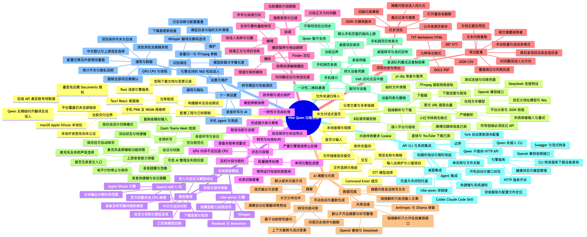

# Vibe Qwen 功能全景

梳理日期：2026-10-28。范围为当前 Vibe fork 的源码、界面入口及配套工程，不包含仓库外的早期 Electron 原型。当前桌面应用实际采用 **Tauri + React + Rust**。

图中“存在功能”表示源码中存在实现或入口，不代表所有平台、引擎和外部服务都已完成实机验收。首页、Qwen 等本次迭代与上游保留能力同时列出；实际验证范围见下方限制说明。



[打开可缩放 SVG](features.svg) · [打开高清 PNG](features.png) · [打开 PDF](features.pdf) · [编辑 Mermaid 源文件](features.mmd)

## 功能与源码索引

| 功能分支 | 主要内容 | 源码入口 |
| --- | --- | --- |
| 首页与输入 | 中文输入框、分享文案、多链接、本地文件及文件夹、拖放、附件暂存、模型选择、快捷提交 | [首页](../desktop/src/pages/main/page.tsx)、[输入组件](../desktop/src/pages/main/components/idle-hero.tsx)、[提交编排](../desktop/src/pages/main/hooks/use-media-composer.ts) |
| 链接解析与下载 | 在线模型严格解析、平台分类、结果校验、yt-dlp 下载、FFmpeg 校验、取消及清理 | [前端解析](../desktop/src/lib/media-input.ts)、[原生解析](../desktop/src-tauri/src/cmd/media_input.rs)、[下载器](../desktop/src-tauri/src/cmd/media_download.rs) |
| 本地语音模型 | Qwen3-ASR-1.7B、Whisper、Parakeet、Nemotron；下载、校验修复、导入、自定义地址、切换和任务期间锁定 | [Qwen 引擎](../desktop/src-tauri/src/qwen)、[Qwen 管理](../desktop/src/pages/settings/sections/qwen-model.tsx)、[模型管理](../desktop/src/pages/settings/sections/models.tsx)、[模型锁](../desktop/src/lib/model-lock.ts) |
| 转写与任务队列 | 顺序批处理、实时片段、单项及整批进度、任务状态、取消、准备失败重试、GPU 失败回退及自动保存 | [任务队列](../desktop/src/pages/main/hooks/use-transcribe-queue.ts)、[会话](../desktop/src/pages/main/session.tsx)、[转写分流](../desktop/src-tauri/src/cmd/transcribe.rs) |
| 结果阅读、编辑与播放 | 段落编辑、搜索、时间戳、说话人、阅读方向、播放跟随、跳转、倍速、保存媒体及 Finder 定位 | [结果](../desktop/src/pages/main/components/transcript-view.tsx)、[工具栏](../desktop/src/pages/main/components/transcript-toolbar.tsx)、[播放器](../desktop/src/pages/main/components/player-bar.tsx) |
| 项目历史与导出 | 最近记录、搜索、重命名、删除、媒体副本、旧记录兼容；九种格式、主题预览、批量及自动导出 | [项目存储](../desktop/src/lib/transcripts-store.ts)、[历史侧栏](../desktop/src/pages/main/components/recents-sidebar.tsx)、[导出对话框](../desktop/src/pages/main/components/transcript-export-dialog.tsx)、[自动导出](../desktop/src/lib/auto-export.ts) |
| AI 摘要与问答 | DeepSeek、OpenAI 兼容接口、Claude、Ollama；摘要预设、分块汇总、流式答案、基于转写的问答和持久化 | [连接配置](../desktop/src/pages/settings/sections/ai.tsx)、[模型客户端](../desktop/src/lib/ai/client.ts)、[摘要与问答](../desktop/src/pages/main/hooks/use-summaries.ts)、[问答界面](../desktop/src/pages/main/components/summary-view.tsx) |
| 录音、听写与会议 | 保留麦克风和系统声音录制、快捷键听写、复制或模拟键入、可选 AI 整理、会议检测提醒及权限检查 | [录音设置](../desktop/src/pages/settings/sections/recording.tsx)、[听写](../desktop/src/providers/hotkey.tsx)、[原生录音](../desktop/src-tauri/src/cmd/audio.rs)、[会议提醒](../desktop/src/windows/meeting-prompt-window.tsx) |
| 手机接力 | 二维码配对、设备撤销、手机网页录音、发送队列、点对点及中继传输、桌面转写回传 | [桌面设置](../desktop/src/pages/settings/sections/phone.tsx)、[桌面协议](../desktop/src-tauri/src/handoff)、[手机网页](../handoff/pwa) |
| API、CLI 与系统集成 | HTTP 音频接口、Swagger、流式转录、独立 CLI、Codex/Claude Code Skill、托盘、单实例、深链接、文件打开和窗口状态 | [API 设置](../desktop/src/pages/settings/sections/api.tsx)、[服务端](../server/crates/vibe-server/src/server)、[CLI](../server/crates/vibe-server/src/cli.rs)、[桌面启动](../desktop/src-tauri/src/main.rs) |
| 设置与维护 | 十一个设置分类、语言与主题、项目目录、隐私、自动导出、识别调优、下载器更新、日志、配置迁移和重置 | [设置中心](../desktop/src/pages/settings/page.tsx)、[偏好配置](../desktop/src/providers/preference.tsx)、[初始化与清理](../desktop/src-tauri/src/setup.rs) |
| 配套工程与边界 | 桌面端、Rust 引擎服务、手机 PWA 和网络桥、官网、构建脚本、测试及本地交付限制 | [构建说明](BUILDING.md)、[server](../server)、[handoff](../handoff)、[website](../website)、[scripts](../scripts) |

九种导出格式为 TXT、Markdown、SRT、VTT、HTML、JSON、CSV、DOCX 和 PDF；文本类格式也支持直接复制内容。录音能力仍保留在快捷键、设置及会议提醒链路中，首页当前以文件和链接为主入口。

## 当前限制与验收范围

- **Qwen**：当前提供 macOS Apple Silicon 本地 CPU 推理，使用 Accelerate；按约 20 秒分块输出，时间戳为粗范围。尚无精细对齐、翻译和说话人分离；未接入手机接力、HTTP API 和独立 CLI。Whisper 等引擎的选项按自身能力启用，不能视为 Qwen 同时支持。全局听写走统一模型分流，代码路径可达，本轮未实测。
- **在线文本模型**：链接必须经过在线 OpenAI 兼容接口或 DeepSeek；未配置或调用失败时保留输入并提示，本地文件转写不依赖它。Claude、Ollama 保留用于摘要等功能。尚未使用真实账号完成在线模型联调。链接解析发送输入文案，摘要及问答会发送相应转写内容，自动摘要和 AI 听写整理默认关闭。
- **视频平台**：YouTube 和音视频直链完成实际下载及音轨校验，直链另完成 Qwen 转写与项目保存；微博只验证到媒体信息。当前样例中 B站返回 412、小红书未发现可用格式、抖音要求 Cookie，因此不能宣称已全面支持这些平台。具体证据见[平台验收记录](../plans/homepage-media-input/platform-validation.md)。
- **上游保留能力**：桌面默认中文，但仍保留多语言设置；手机网页仍含英文，默认地址仍指向上游 GitHub Pages。手机接力并非项目云同步；当前 fork 自动更新地址为空。分析统计是否实际发送还取决于用户开关和构建时 Aptabase 配置。
- **本地交付**：当前为本地开发签名，尚未公证；重签名后 macOS 可能重新请求 Documents 权限。最近验收停留在系统授权弹窗，原有三条项目记录仍保留，不能把权限未完成误写为数据丢失。见[本地交付验收记录](../plans/homepage-media-input/homepage-media-input_002.md)。

实现和使用说明：[首页输入](../HOMEPAGE.md)、[Qwen 模型](../QWEN.md)。

## 更新导图

修改 `docs/features.mmd` 后，在仓库根目录执行以下命令重新生成。Mermaid CLI 仅作为临时文档工具运行，不加入应用依赖；需要可用的 Chromium，已有 Chrome 时可通过 `PUPPETEER_EXECUTABLE_PATH` 指定路径。

```sh
pnpm dlx @mermaid-js/mermaid-cli@11.12.0 -i docs/features.mmd -o docs/features.svg -b white
pnpm dlx @mermaid-js/mermaid-cli@11.12.0 -i docs/features.mmd -o docs/features.png -w 2800 -H 1400 -b white
pnpm dlx @mermaid-js/mermaid-cli@11.12.0 -i docs/features.mmd -o docs/features.pdf -f -b white
```
